# RadarIsu

**Sistem peringatan dini isu, koordinasi akun, dan peniruan identitas di ruang siber sosial untuk perlindungan institusi.**

RadarIsu membantu analis dan pimpinan melihat isu yang mulai menguat di media sosial lebih cepat. Sistem menandai pola yang tidak wajar (lonjakan volume, akun yang memposting serentak, teks yang sangat mirip, akun baru, dan akun yang menyerupai akun resmi). Sistem tidak memutuskan apa pun. Keputusan akhir selalu di tangan manusia.

> Purwarupa untuk Kartika Cyber Hackathon 2026. Seluruh data di repo ini adalah **data simulasi** dan ditandai sebagai demikian di setiap layar.

---

## Tampilan aplikasi

Screenshot diambil dari purwarupa yang berjalan dengan data demo. Semua berkas ada di folder [`screenshoots/`](screenshoots/).

### Masuk

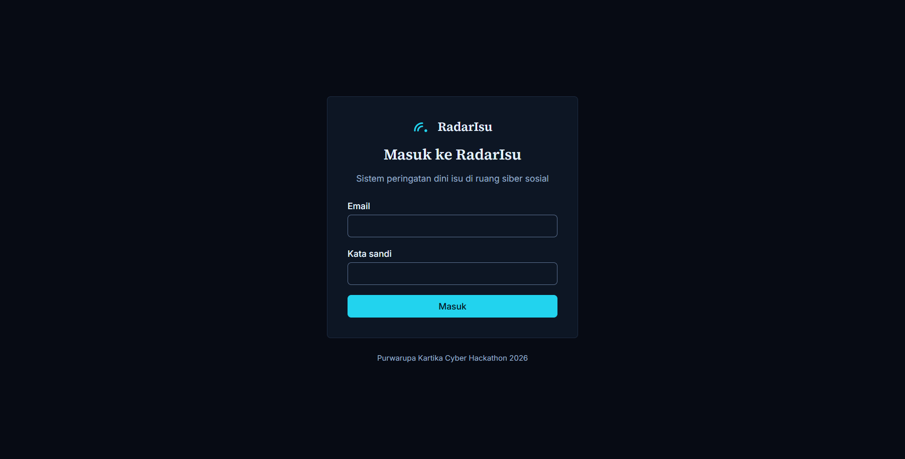

### Peran Admin

| Status sistem | Sumber data |
|---|---|
| 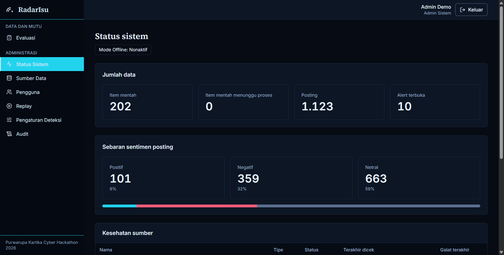 | 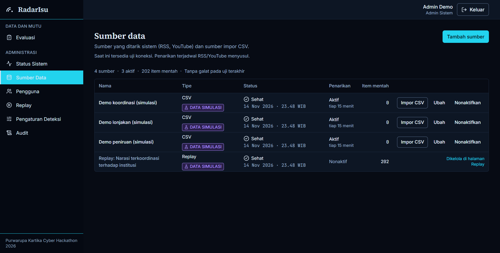 |

| Pengguna | Replay |
|---|---|
| 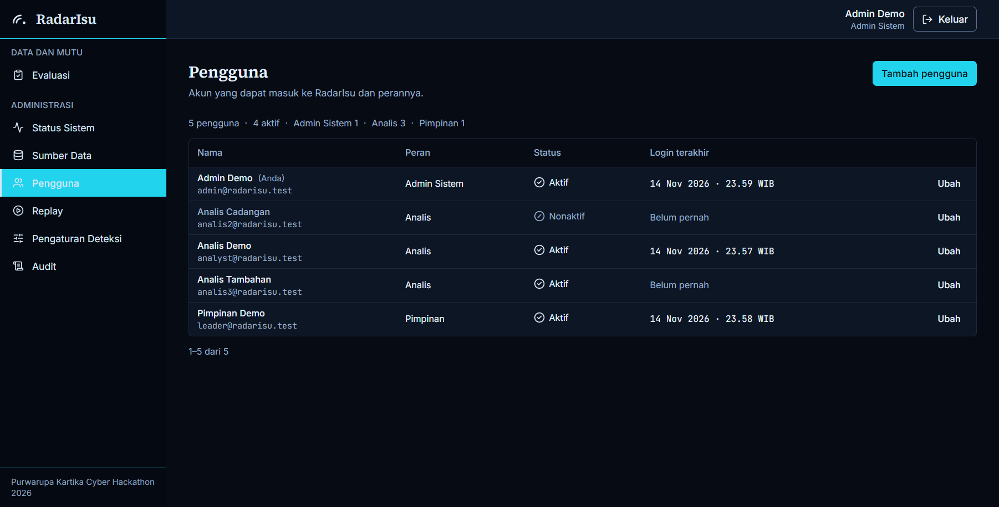 | 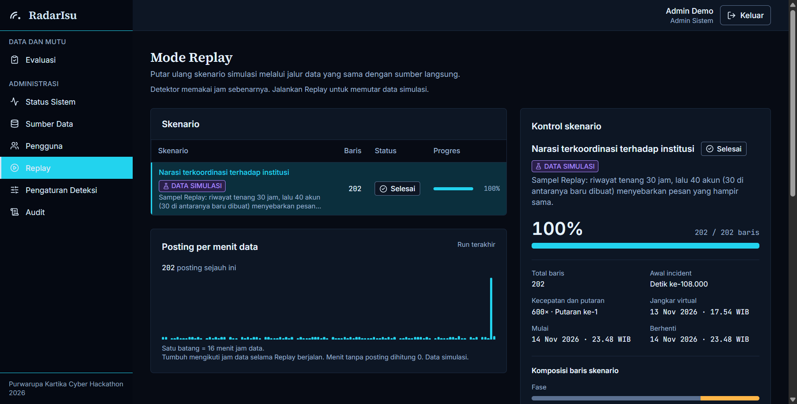 |

| Pengaturan deteksi | Audit |
|---|---|
| 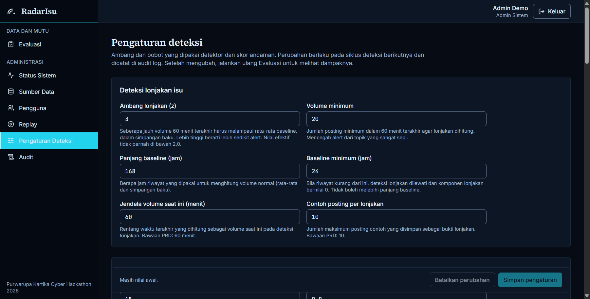 | 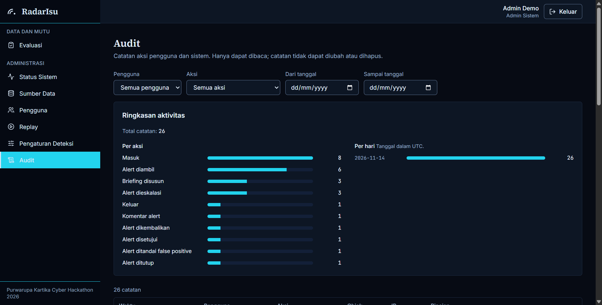 |

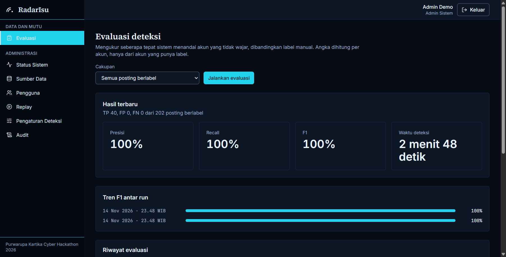

### Peran Analis

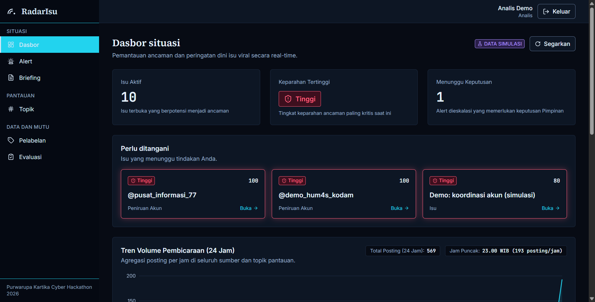

| Daftar alert | Detail alert |
|---|---|
| 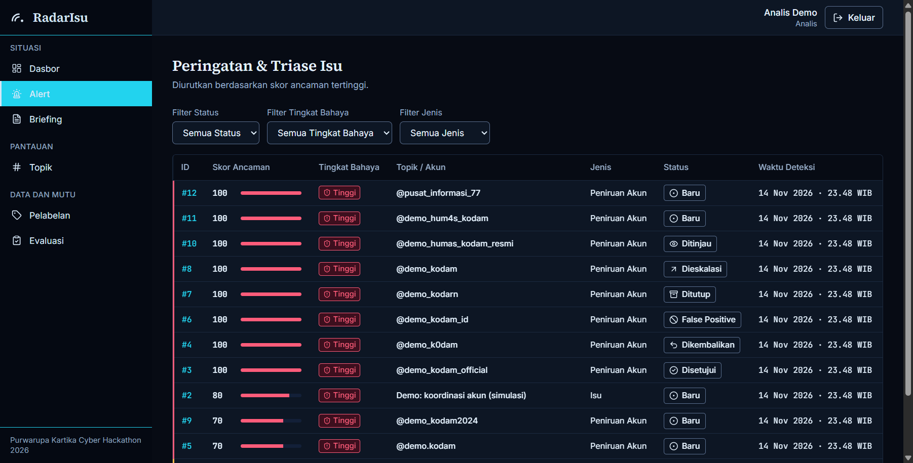 | 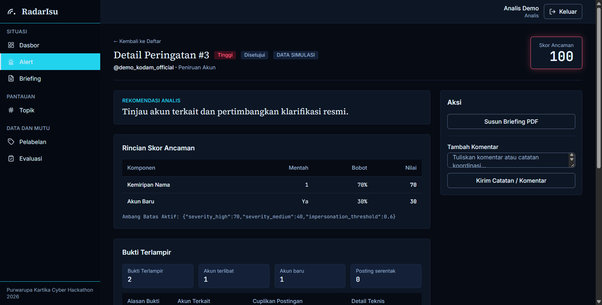 |

| Briefing | Topik pantauan |
|---|---|
| 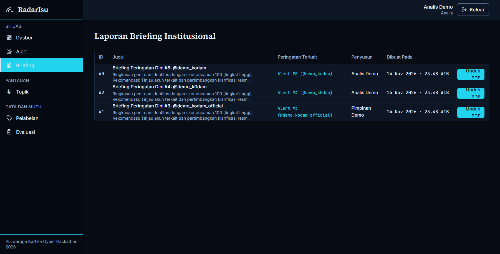 | 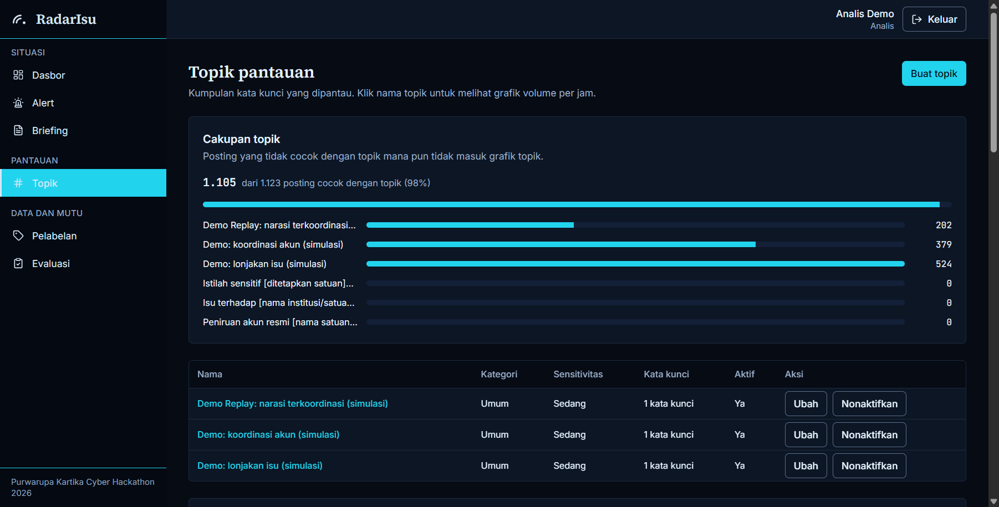 |

| Detail topik | Pelabelan data |
|---|---|
| 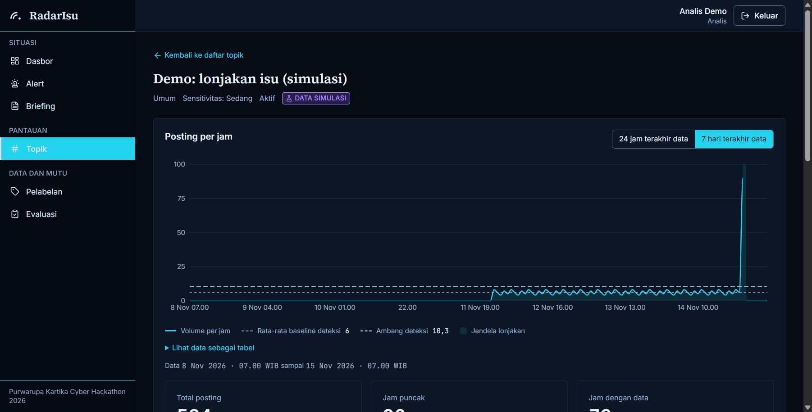 | 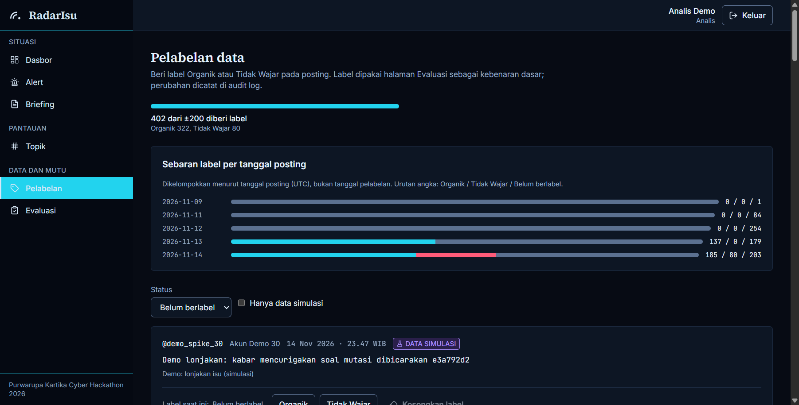 |

### Peran Pimpinan

| Dasbor | Daftar alert |
|---|---|
| 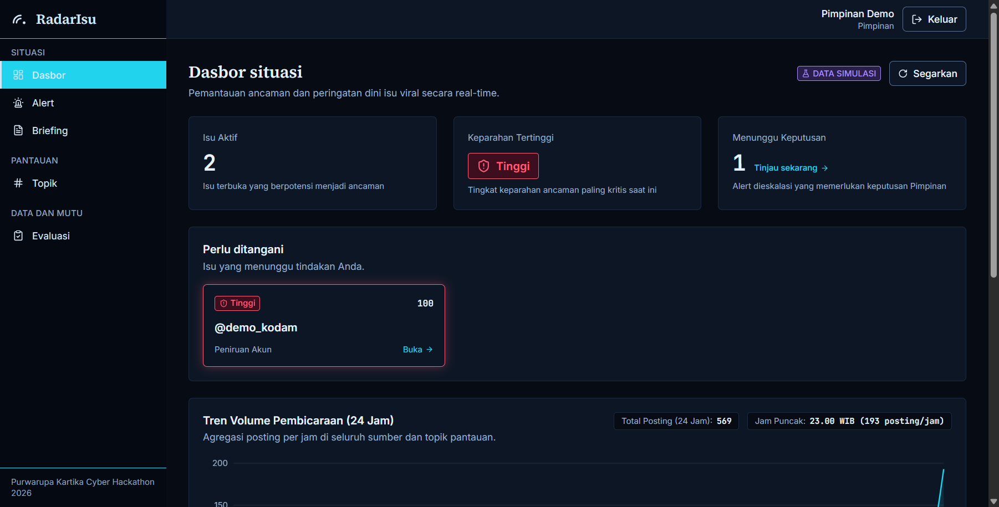 | 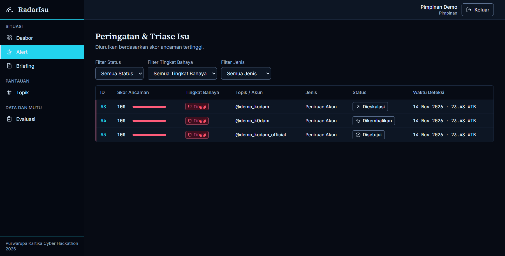 |

---

## Fitur

Ruang lingkup mengikuti PRD §6.1.

| ID | Fitur | Peran utama |
|---|---|---|
| F1 | Manajemen sumber data dan impor CSV | Admin |
| F2 | Topik pantauan, templat UC1–UC3, dan daftar akun resmi | Analis |
| F3 | Deteksi lonjakan volume | Sistem |
| F4 | Deteksi koordinasi akun (klaster teks mirip, akun baru, posting serentak) | Sistem |
| F5 | Sentimen berbasis kamus | Sistem |
| F6 | Alert, triase, eskalasi, dan komentar | Analis, Pimpinan |
| F7 | Skor ancaman yang transparan (rincian per komponen) | Sistem |
| F8 | Dasbor situasi | Analis, Pimpinan |
| F9 | Briefing PDF | Analis, Pimpinan |
| F10 | Audit log (hanya baca) | Admin |
| F11 | Mode Replay: memutar ulang skenario simulasi lewat jalur data yang sama dengan data nyata | Admin |
| F12 | Autentikasi dan kontrol akses berbasis peran | Semua |
| F13 | Deteksi potensi peniruan akun resmi | Sistem |
| F14 | Pelabelan data manual dan halaman evaluasi | Analis (label), semua (lihat) |
| F15 | Pengaturan deteksi (ambang dan bobot) | Admin |

Tidak ada model bahasa besar atau layanan pihak ketiga dalam fitur wajib. Semua penilaian berasal dari aturan dan kamus yang bisa dibaca.

---

## Teknologi

| Lapisan | Teknologi |
|---|---|
| Backend | Laravel 13 (PHP 8.3), Laravel Sanctum, antrean database |
| Frontend | Next.js 16 (App Router, TypeScript), Tailwind CSS v4, Recharts, lucide-react |
| Basis data | PostgreSQL 16 dengan `pg_trgm` |
| Pengujian | PHPUnit (backend), Vitest (frontend) |
| Penyebaran | Docker Compose (nginx, app, queue, scheduler, postgres, frontend) |

Frontend bertindak sebagai BFF: browser hanya berbicara dengan Next.js, dan token disimpan di cookie httpOnly. Laravel memeriksa setiap permintaan.

---

## Struktur repo

```
backend/     API Laravel (routes/api/*.php, app/Services/*, tests/)
frontend/    Aplikasi Next.js (src/app, src/components, src/lib)
docs/        PRD, desain UI, kepemilikan domain, handoff, pertanyaan terbuka
screenshoots/ tangkapan layar halaman
docker/      konfigurasi nginx dan Dockerfile pendukung
```

Dokumen penting:
- `docs/PRD.md`: sumber kebenaran produk.
- `docs/UI_DESIGN_SYSTEM.md`: token warna, tipografi, dan aturan komponen (tema Cyber).
- `docs/OWNERSHIP.md`: pembagian domain dan siapa mereview apa.
- `docs/HANDOFF.md`: perubahan yang menyentuh domain lain.
- `docs/OPEN_QUESTIONS.md`: konflik dan keputusan yang tercatat.

---

## Menjalankan dengan Docker

1. Salin `.env.example` menjadi `.env`, lalu isi nilai yang kosong:
   - `APP_KEY`: hasil dari `docker compose run --rm app php artisan key:generate --show`.
   - `DB_PASSWORD`: kata sandi PostgreSQL.
   - `DEMO_USER_PASSWORD`: kata sandi akun demo. Wajib diganti untuk penyebaran sungguhan.
2. Jalankan layanan:
   ```bash
   docker compose up -d --build
   ```
3. Isi data awal (seeder tidak berjalan otomatis):
   ```bash
   docker compose exec app php artisan migrate --force
   docker compose exec app php artisan db:seed --force
   ```
4. Buka http://localhost:3000.

Layanan `queue` menjalankan antrean, termasuk pipeline dan replay. Tanpa worker, data impor tetap menunggu di `raw_items`.

## Menjalankan tanpa Docker

Prasyarat: PHP 8.3 dengan ekstensi `pdo_pgsql`, `intl`, dan `mbstring`; Composer; Node.js 20 atau lebih baru; PostgreSQL 16 dengan ekstensi `pg_trgm`.

**Backend**
```bash
cd backend
composer install
cp .env.example .env            # isi DB_* dan APP_KEY
php artisan key:generate
php artisan migrate --force
php artisan db:seed --force
php artisan serve               # http://127.0.0.1:8000
```

Di terminal lain jalankan worker. Replay memakai antrean `replay`, jadi keduanya perlu:
```bash
php artisan queue:work --queue=replay,default --tries=3
```

**Frontend**
```bash
cd frontend
npm install
npm run dev                     # http://localhost:3000
```

Frontend membaca `LARAVEL_URL` (bawaan `http://127.0.0.1:8000`).

> Jangan jalankan `npm run build` saat `npm start` masih berjalan di port yang sama. Build menghapus berkas chunk yang masih dipakai server.

---

## Akun demo

| Peran | Email | Yang bisa dilakukan |
|---|---|---|
| Admin | `admin@radarisu.test` | Sumber data, pengguna, replay, pengaturan deteksi, audit, status, evaluasi |
| Analis | `analyst@radarisu.test` | Dasbor, alert dan triase, briefing, topik, pelabelan, evaluasi |
| Pimpinan | `leader@radarisu.test` | Dasbor, alert yang dieskalasi (setujui atau kembalikan), briefing, evaluasi (lihat) |

Kata sandi: nilai `DEMO_USER_PASSWORD` (bawaan `radarisu-demo-2026`).

---

## Data demo dan replay

Urutan ini menyiapkan data yang dipakai screenshot dan alur demo:

```bash
php artisan db:seed --class=SpikeDemoSeeder
php artisan db:seed --class=CoordinationDemoSeeder
php artisan db:seed --class=ImpersonationDemoSeeder
php artisan db:seed --class=LabelingDemoSeeder
php artisan db:seed --class=DemoScenarioSeeder
php artisan radarisu:detect --sync          # menghasilkan alert
php artisan radarisu:evaluate               # menghitung evaluasi
```

Untuk memutar skenario dari halaman **Replay**, admin menekan *Mulai* dengan kecepatan tertentu (misalnya 600× untuk demo cepat, 10× untuk melihat grafik tumbuh). Worker `replay` harus berjalan. Setiap run menambah posting baru; lihat `docs/OPEN_QUESTIONS.md` #28.

Pertimbangkan membangun ulang database (`php artisan migrate:fresh --seed`) sebelum demo, supaya angka yang tampil konsisten.

---

## Pengujian dan verifikasi

```bash
cd backend && php artisan test          # 733 tes
cd frontend && npm run lint && npx tsc --noEmit && npm test && npm run build
```

Pemeriksaan aturan desain (tidak boleh ada output):
```bash
rg -n "#[0-9A-Fa-f]{3,8}\b|rgba?\(|hsla?\(" frontend/src --glob '!**/globals.css' --glob '!**/*.test.*' --glob '!**/fixtures/**'
```

---

## Batasan yang harus diketahui

- **Semua data adalah simulasi.** Tidak ada posting nyata di repo. Setiap layar yang memuat data simulasi diberi penanda "DATA SIMULASI".
- **Sentimen berbasis kamus** sederhana. Pada data demo, sebagian besar posting netral karena tidak memuat kata bermuatan yang cukup. Kamus dan rumus sudah dibahas di `docs/OPEN_QUESTIONS.md`.
- **Evaluasi dikalibrasi pada data yang sama** dengan yang diukur, sehingga angka 100% pada data demo tidak boleh dibaca sebagai kemampuan deteksi di lapangan. Batasannya tertulis di halaman evaluasi.
- **Waktu deteksi bisa negatif.** Artinya alert terdeteksi sebelum awal insiden di data skenario, dan ditampilkan sebagai "N sebelum insiden".
- Fitur yang ditunda (PRD §6.2): notifikasi Telegram, graf jaringan, draf klarifikasi dengan model bahasa lokal, skor klasifikasi hoaks, peta, autentikasi dua faktor, dan PWA belum dibangun.

---

## Tim

Pembagian domain mengikuti `docs/OWNERSHIP.md`:

| Domain | Pemilik |
|---|---|
| A: Data dan deteksi | Naufal |
| B: Keamanan dan alur (alert, briefing) | Kadavi |
| C: Skor dan produk (dasbor, sentimen) | Rekishi |

Perubahan lintas domain dicatat di `docs/HANDOFF.md`. Setiap perubahan lintas domain direview pemiliknya lewat pull request.
